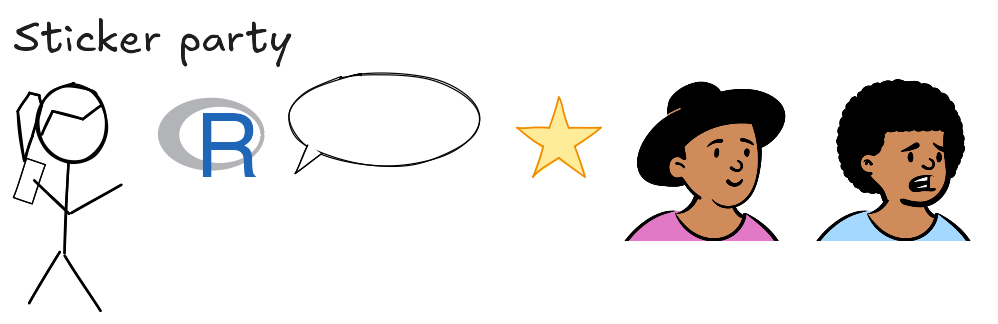
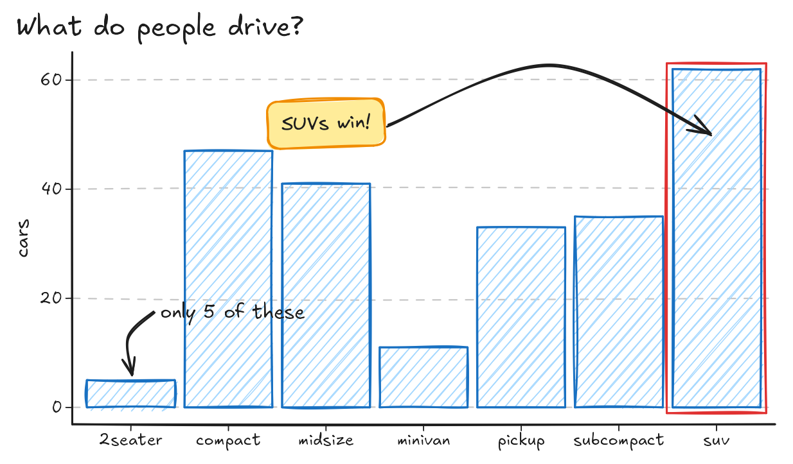
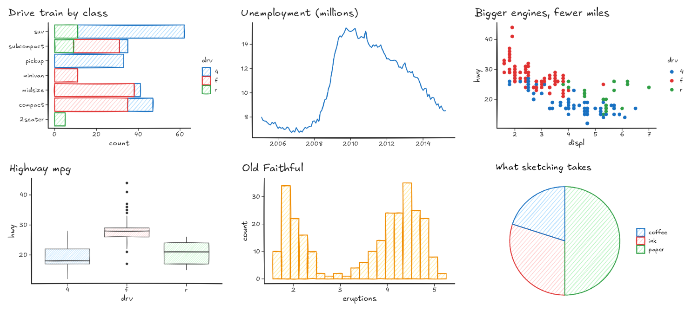
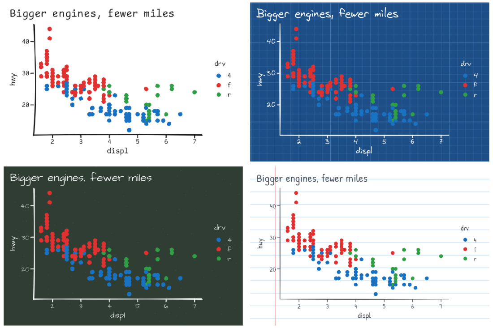
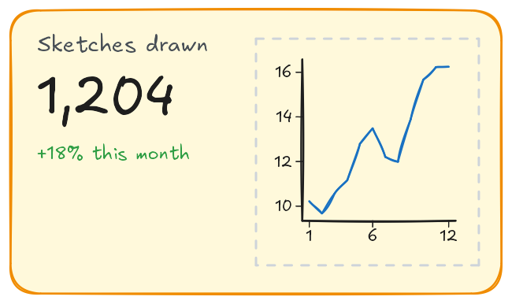
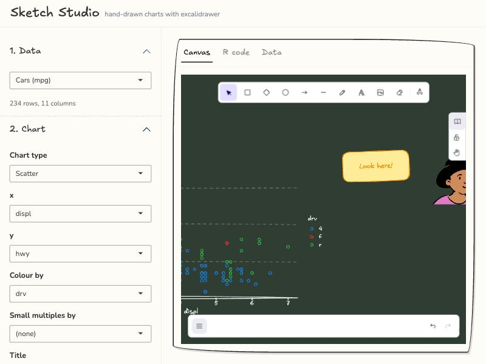
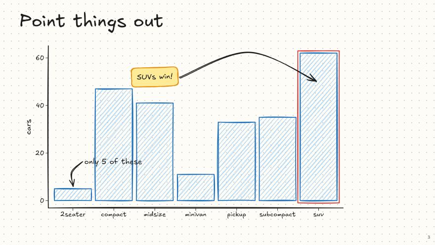
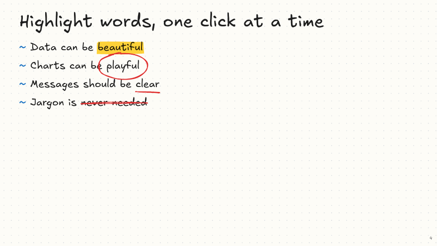

# excalidrawer 

**Hand-drawn charts, drawings and slides from R, in the style of [Excalidraw](https://excalidraw.com).**

excalidrawer turns ggplot2 and base R plots into **editable Excalidraw drawings**.
It draws them offline in R with the same rough.js engine, seeds and handwriting
fonts that Excalidraw uses, so you get:

- hand-drawn PNG, SVG and PDF images for reports and Quarto documents;
- animated SVGs and GIFs of the drawing sketching itself;
- `.excalidraw` files to open and adjust by hand at excalidraw.com, in VS Code or in Obsidian;
- the real Excalidraw editor inside RStudio and Shiny;
- a point-and-click app, **Sketch Studio**;
- hand-drawn Quarto slides and PowerPoint decks.

> Not affiliated with or endorsed by Excalidraw.



## Install

```r
# from a local copy of the package
devtools::install("path/to/excalidrawer")
```

## Charts

Write normal ggplot2 code, then sketch it or turn it into an Excalidraw scene:

```r
library(ggplot2)
library(excalidrawer)

p <- ggplot(mpg, aes(class)) + geom_bar(fill = "#a5d8ff") +
  labs(title = "What do people drive?", x = NULL, y = "cars")

sketch(p)                                         # draw it hand-drawn style
ggsave("cars.png", sketch(p), width = 8, height = 5)

s <- as_excalidraw(p) |>                           # an editable drawing...
  exc_mark(x = "suv", y = c(0, 62), type = "box") |>   # ...annotated with data values
  exc_note("SUVs win!", x = "midsize", y = 52, to = c("suv", 50)) |>
  exc_callout("only 5 of these", x = "2seater", y = 5)

exc_save(s, "cars.png", scale = 2)                # PNG, SVG (fonts embedded) or PDF
exc_animate(s, "cars.svg")                        # an SVG (or GIF) that draws itself
write_excalidraw(s, "cars.excalidraw")            # open at excalidraw.com
write_excalidraw(s, "cars.excalidraw.svg")        # an image that stays editable
write_excalidraw(s, "cars.excalidraw.md")         # for Obsidian's Excalidraw plugin
s <- exc_edit(s)                                  # edit by hand, get it back in R
```

It works with almost any plot, including facets, flipped coordinates, pies,
boxplots, histograms and base R graphics (`as_excalidraw(~ hist(x))`).



Change the whole look with a preset (`whiteboard`, `xkcd`, `blueprint`,
`chalkboard`, `pencil`, `marker`), a paper background, a fill style or a
font:

```r
sketch(p, preset = "chalkboard")
exc_restyle(s, "blueprint") |> exc_save("blueprint.png")
as_excalidraw(p, fill_style = "cross-hatch", roughness = "cartoonist", font = "Virgil")
```



## Drawings

Build scenes from Excalidraw's own shapes, read any Excalidraw file, and
render or edit it:

```r
exc_scene(
  exc_rect(0, 0, 160, 80, label = "Idea", fill = "yellow", fill_style = "solid", rounded = TRUE),
  exc_arrow(c(170, 300), c(40, 40), label = "becomes"),
  exc_ellipse(310, 0, 160, 90, label = "Chart", fill = "blue", fill_style = "hachure")
) |>
  exc_save("idea.png")

exc_mermaid("flowchart LR\n  Data --> Sketch --> Share")   # Mermaid -> Excalidraw shapes
read_excalidraw("drawing.excalidraw") |> plot()
```

Add **stickers** from twelve Excalidraw community libraries (R icons, stick
figures, emojis, speech bubbles, sticky notes...) and **hand-drawn people**
from Open Peeps:

```r
exc_stickers()                         # what's available
exc_sticker_sheet("emojis") |> plot()  # preview a library
s |> exc_sticker("r-icons:1", x = 600, y = 20, width = 80) |>
  exc_peep(700, 20, seed = "Ada", face = "smile")
```

**Templates**: draw a card in Excalidraw with `{{placeholders}}` and fill it
from data, one image per row:

```r
exc_template_render("kpi-card.excalidraw", kpis, dir = "cards", file = "{metric}.png",
                    charts = list(trend = function(row) make_trend_plot(row)))
```



## Sketch Studio

```r
run_sketch_studio()
```

A point-and-click app around the live Excalidraw editor. Pick data, a chart
and a style; add notes, stickers, people and Mermaid diagrams; then export
PNG, SVG, PDF, `.excalidraw`, `.excalidraw.md`, `.excalidraw.svg` or the R
code for the chart. Changing a setting swaps only the chart, so anything you
drew by hand stays.



## Slides

```r
use_excalidraw_slides("talk")    # a Quarto deck using format: excalidraw-revealjs
# quarto render talk/slides.qmd, then exc_slides_pdf("talk/slides.html")
exc_pptx(list(p, s), "talk.pptx", titles = c("What people drive", "SUVs win"))
```

The Quarto format brings Excalifont, Excalidraw colours, paper backgrounds,
sticky notes, sketchy boxes and hand-drawn marks that you can reveal one click
at a time: `[word]{.rn-circle .fragment}`. PowerPoint slides hold the drawings
as editable vector shapes.

 

## How it works

The package keeps scenes as Excalidraw's own JSON, so files round-trip with
nothing lost. The native renderer runs a port of Excalidraw's shape code with
rough.js inside V8, then draws the strokes with grid and places text using
Excalidraw's font metrics. The editor widget is the real `@excalidraw/excalidraw`
0.18 bundle, served locally so it works offline. Plots are converted by
capturing them with svglite and rebuilding each line, box, point and label as
an Excalidraw element.

## Credits

Bundled third-party pieces keep their own licences (see `inst/COPYRIGHTS` and
`inst/fonts/LICENSES/`):

- rough.js (MIT, Preet Shihn)
- perfect-freehand (MIT, Steve Ruiz)
- lz-string (MIT)
- DiceBear with Pablo Stanley's Open Peeps (MIT code, CC0 art)
- the Excalidraw editor and the excalidraw-libraries stickers (MIT)
- Excalifont and Virgil (OFL-1.1)
- Comic Shanns (MIT)
- Caveat, Patrick Hand, Architects Daughter, Gochi Hand, Nunito, Lilita One and Cascadia Code (OFL-1.1)
